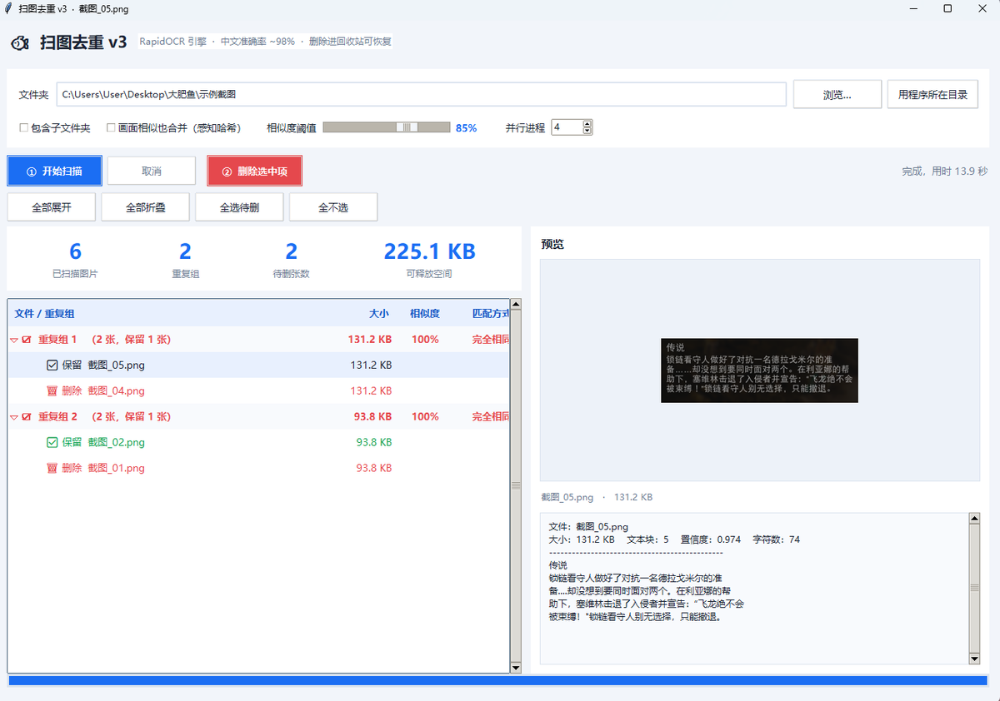

# 扫图去重 v3（Screenshot Dedup）

找出**文字内容重复的截图**，每个重复组只保留一张，其余的**移入回收站**（可随时恢复，不会硬删除）。

专为清理游戏截图 / 聊天截图 / 攻略截图这类「图不一样、文字一样」的场景设计——按 OCR 识别出的文字判断重复，而不是按文件哈希。



## 功能

- **按文字判重**：RapidOCR（PP-OCRv4）识别中文，2-gram + 3-gram Dice 相似度，默认阈值 85%
- **删除走回收站**：调用 `send2trash`，误删可从回收站还原
- **保留最优图**：每个重复组自动保留文件体积最大（通常也最清晰）的那张
- **多进程 OCR**：默认 4 进程，扫描结果有本地缓存（同一张图第二次扫描秒过）
- **感知哈希**（可选）：文字识别不到的纯图像重复也能合并
- **能预览**：左侧列表选中任意一张，右侧直接看图和识别出的文字
- 记住上次用的文件夹、单实例运行、崩溃日志

## 使用

1. 双击 `扫图去重v3.exe`（或从源码 `python main.py` 启动）
2. 选文件夹 → **① 开始扫描**
3. 结果里勾选要处理的重复组（默认已勾好「删除」项）
4. **② 删除选中项** → 确认 → 文件进回收站
5. 删完可一键重新扫描刷新列表

支持格式：`.png .jpg .jpeg .bmp .tif .tiff .webp`

> 首次扫描要加载 OCR 模型，进度条会显示「识别中」；扫描期间按钮会变成「扫描中…」，这是正常状态。

## 从源码运行

```bash
pip install -r requirements.txt
python main.py
```

隐藏命令行自检模式（不需要界面，用于验证 OCR 是否正常）：

```bash
python main.py --selftest "图片文件夹" "输出结果.txt"
```

输出示例：

```
OK images=3 groups=1 delete=1 bytes=109409 elapsed=8.6
GROUP1 type=完全相同 sim=1.000 n=2 keep=图1_副本.png text=传说在一座大山深处……
   DEL 图1.png 106.8 KB
TEXTDETECTED=3/3
```

## 打包

```bash
pip install "pyinstaller==6.21.0"
python -m PyInstaller build.spec --noconfirm --clean
```

产物在 `dist/扫图去重v3/`（onedir 目录版）。

两点踩坑记录：

- **必须用 onedir**。单文件模式要把 ~240MB 解压到临时目录，某些机器上这一步会失败，程序会卡在一个看不见的 `Could not create temporary directory!` 对话框上，表现为「双击没反应」。
- **PyInstaller 版本要 ≥ 6.12**。6.11 的 numpy hook 不认 numpy 2.x 的 `_core` 布局，打出来的 exe 会 OCR 全空（`ModuleNotFoundError: No module named 'numpy._core._exceptions'`）。

## 缓存与日志

| 路径 | 说明 |
| --- | --- |
| `%LOCALAPPDATA%\ScreenshotDedupV2\*.pkl` | 每张图的 OCR 结果缓存（按 路径+大小+修改时间 命中） |
| `%LOCALAPPDATA%\ScreenshotDedupV2\config.json` | 上次使用的文件夹 |
| `%LOCALAPPDATA%\ScreenshotDedupV2\error.log` | 崩溃 / 异常日志 |

删掉这个目录即可清空缓存（下次会重新识别，速度变慢属正常）。

## 目录结构

```
main.py          # tkinter 界面、扫描任务、删除任务、自检模式
dedup_core.py    # 相似度算法、分组、保留策略、回收站删除
dedup_ocr.py     # RapidOCR 多进程识别 + 缓存
build.spec       # PyInstaller 打包配置（onedir）
```

## 许可

MIT，见 [LICENSE](LICENSE)。
